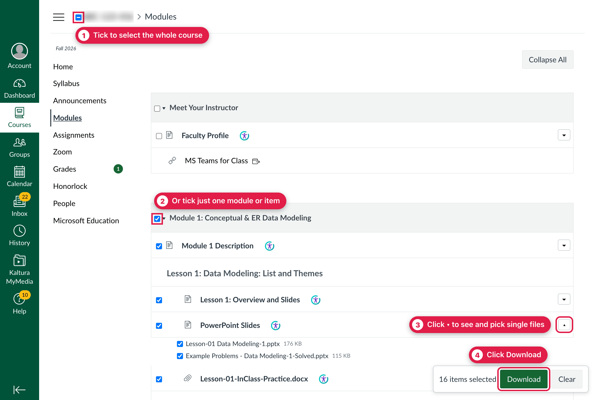
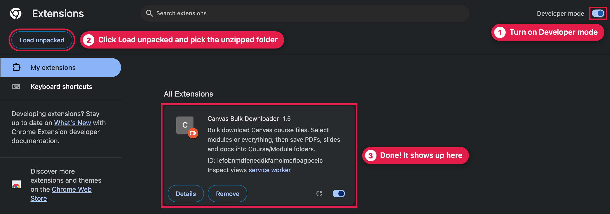
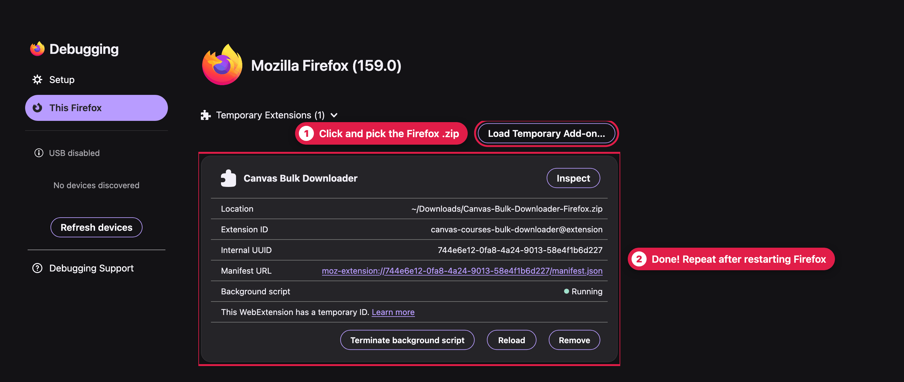
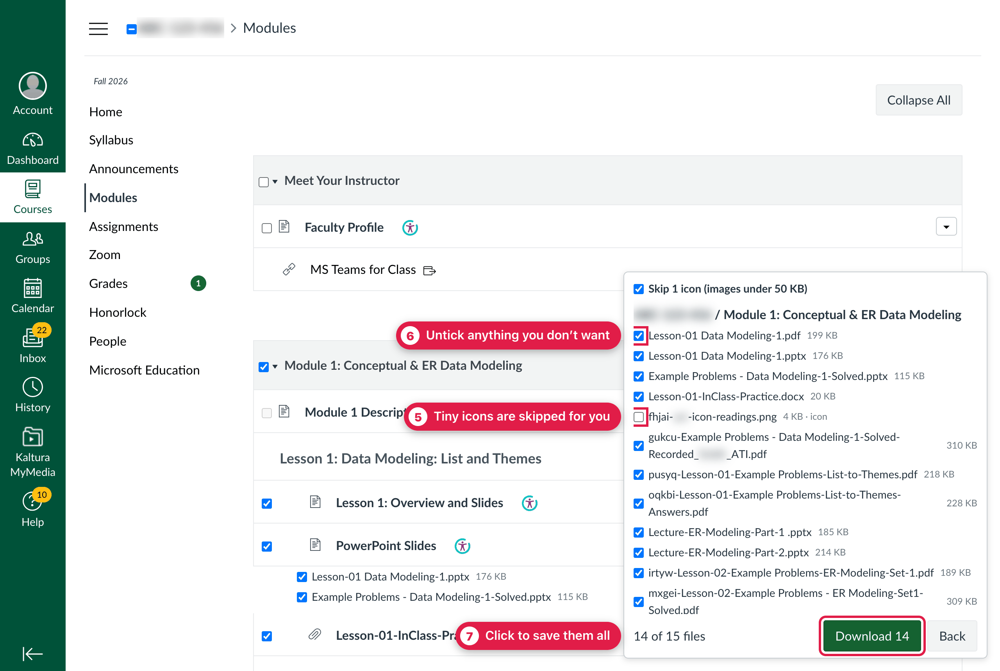

# Canvas Bulk Downloader: Download All Canvas Course Files at Once

[](https://github.com/TouchMyBar/Canvas-Courses-Bulk-Downloader/releases)
[](https://github.com/TouchMyBar/Canvas-Courses-Bulk-Downloader/releases/latest)
[](LICENSE)

**Download all your Canvas course files at once.** No more opening every lecture, PDF, PowerPoint and worksheet one by one. Tick what you want on your course's **Modules** page, click **Download**, and everything is saved into neat folders, one per module. It's ideal for studying offline or keeping your notes after the course ends.

Free and open source. Works in **Chrome, Edge, Brave and Firefox** on Windows, Mac and Linux, with any school that uses **Canvas LMS** by Instructure.



## Install (about 2 minutes)

The extension isn't in the Chrome or Firefox store, so you add it yourself. Just follow the steps for your browser.

### Chrome, Edge or Brave

1. **[Download the Chrome version](https://github.com/TouchMyBar/Canvas-Courses-Bulk-Downloader/releases/latest/download/Canvas-Bulk-Downloader-Chrome.zip)** and double-click the file to unzip it. You'll get a folder.
2. Copy this into your address bar and press Enter: `chrome://extensions`
   (Edge: `edge://extensions` · Brave: `brave://extensions`)
3. Turn on **Developer mode** (top right).
4. Click **Load unpacked** and choose the folder from step 1.



Don't delete or move that folder afterwards. The extension runs from it.

### Firefox

1. **[Download the Firefox version](https://github.com/TouchMyBar/Canvas-Courses-Bulk-Downloader/releases/latest/download/Canvas-Bulk-Downloader-Firefox.zip)**. You don't need to unzip it.
2. Copy this into your address bar and press Enter: `about:debugging#/runtime/this-firefox`
3. Click **Load Temporary Add-on…** and pick the file you downloaded.



Firefox removes it whenever you close Firefox completely. Just repeat steps 2 and 3 next time.

## How to use

1. Open your course in Canvas and click **Modules**.
2. Tick the box next to the course name to get **everything**. You can also tick single modules or items instead, or click **▾** on an item to pick single files.
3. Click **Download** (bottom right).
4. Check the list, untick anything you don't want, then click **Download** again.



Your files are saved in your **Downloads** folder, sorted like this:

```
Downloads/
└── BIO-101/
    ├── Module 1/
    │   ├── Lecture 1 Slides.pptx
    │   └── Worksheet 1.pdf
    └── Module 2/
        └── Lecture 2 Slides.pptx
```

Good to know:

- Tiny images like icons and decorations are skipped for you.
- Files you've already downloaded are marked, and it asks before replacing them.
- If Chrome asks where to save **every** file, turn off **Settings → Downloads → Ask where to save each file before downloading**.

## FAQ

**How do I download all files from a Canvas course at once?**
Install the extension, open the course's Modules page, tick the box next to the course name, and click Download.

**Does it work for my school?**
If your school uses Canvas, it should. That includes schools with their own Canvas address and ones at `yourschool.instructure.com`. It works on the standard Modules page. A newer redesigned Modules page that a few schools are testing isn't supported yet.

**Can I save my Canvas files before the course ends?**
Yes. Schools often remove access to old courses, so download everything while you still can. Files stay on your computer for good.

**Is it free and safe?**
Yes. It's free and open source, so anyone can read the code. It never sees your password and doesn't send your data anywhere (see [Privacy](#privacy)).

**Can I use it on a school laptop or Chromebook?**
Usually not. School-managed computers often block adding extensions. It works on your own computer.

**What can't it download?**
Quizzes, links to other websites, videos (Kaltura, YouTube and similar), and files your teacher has locked.

**Why does the install ask to read data on websites?**
Every school's Canvas has a different web address, so the extension needs permission to run on any site. It stays inactive on any page that doesn't show a Canvas module list.

## Privacy

No tracking, no ads, and nothing is collected or sent anywhere. The extension only talks to your own Canvas site, using the login you already have, and saves files with your browser's normal downloader.

Only download materials you have access to, and follow your school's rules about sharing them.

## For developers

Run `./build.sh` to build the Chrome and Firefox zips into `dist/`. Each zip gets the manifest that browser expects.

## License

[MIT](LICENSE). Not affiliated with Instructure. Canvas is a trademark of Instructure, Inc.
